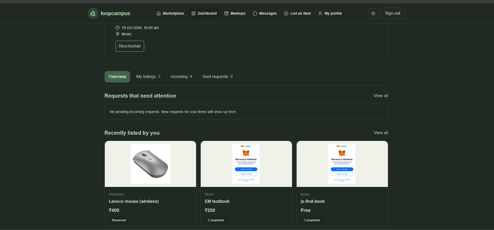
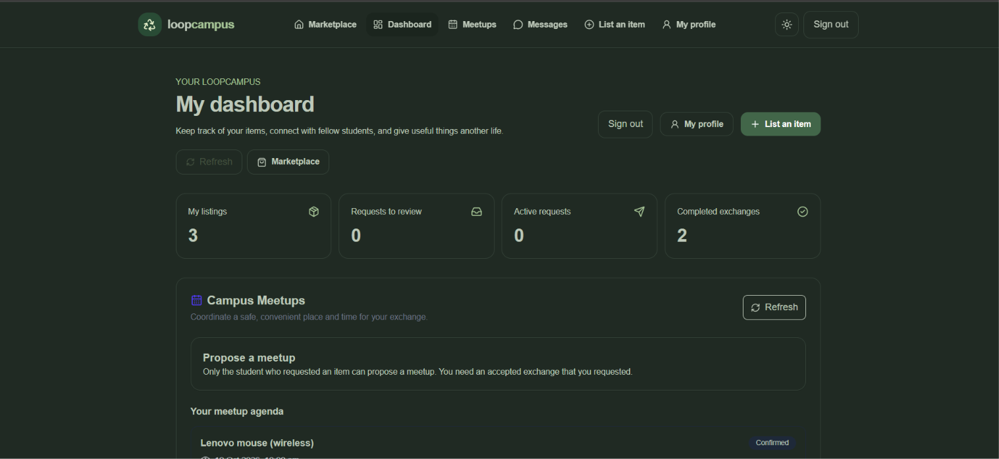
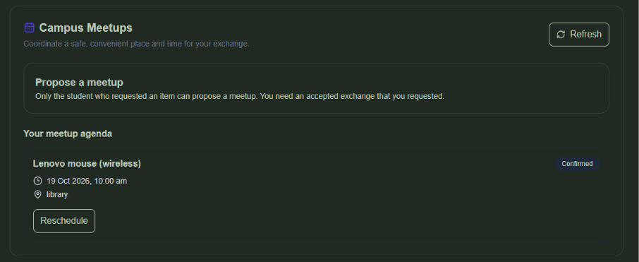
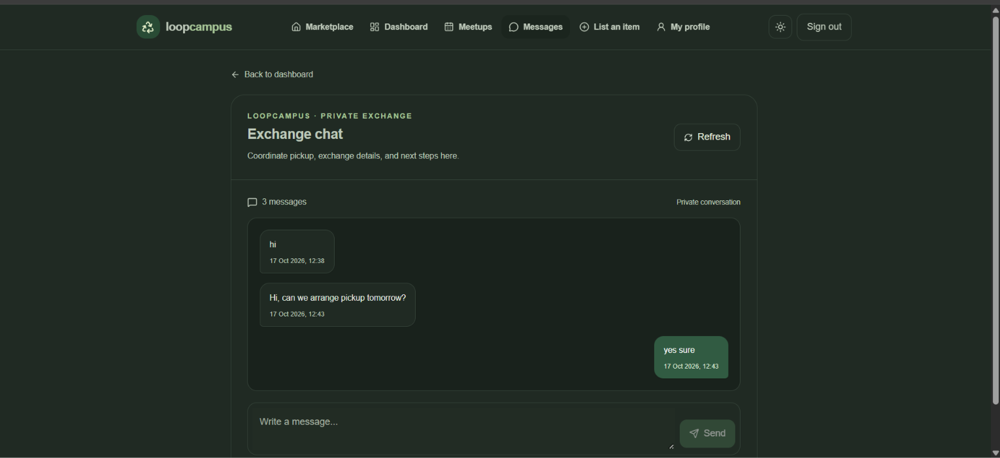
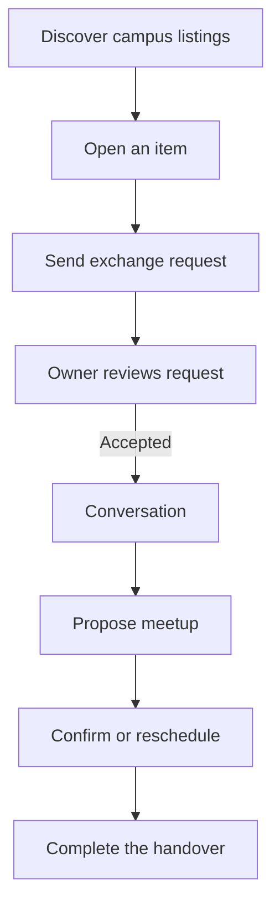
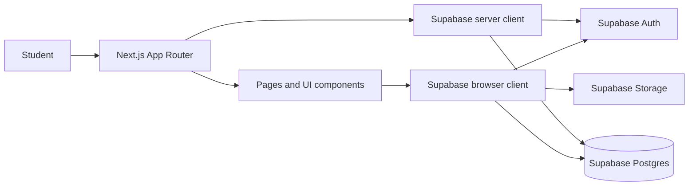

# LoopCampus

**A campus marketplace for sharing useful things, arranging exchanges, and coordinating safe handovers.**

LoopCampus helps students give useful items a second life instead of letting them sit unused. Students can discover campus listings, publish items with clear condition and pricing details, request an exchange, communicate with the other person, and coordinate a meetup from one place.

> Built with Next.js, TypeScript, Tailwind CSS, and Supabase.

Live Deployment : https://vss108-buildathon.vercel.app/

## Why LoopCampus?

Students often have books, stationery, electronics, lab equipment, and other useful items they no longer need, while another student nearby may be looking for exactly those things. LoopCampus brings that exchange into a focused campus experience: easier discovery, clearer item details, a visible request lifecycle, and a place to coordinate the handover.

## Screenshots

### Marketplace
Browse listings and discover items available on campus.



### Dashboard
Manage your listings and exchange requests.



### Meetup Scheduler
Coordinate meetups for exchanges.



### Messaging
Communicate with other students about exchanges.



## Features

### Discover and list items

- Browse available listings from the home page.
- Search listing text and filter by category.
- View item descriptions, condition, price, and photos.
- Publish a listing with a category, condition, free/paid pricing, and images.
- Supported categories: Books, Electronics, Lab Equipment, Stationery, Furniture, and Other.
- Supported item conditions: Like New, Good, Fair, and Needs Repair.

### Exchange workflow

- Send an exchange request with a message.
- Review incoming and outgoing requests from the dashboard.
- Accept, decline, or cancel requests where the workflow permits.
- Track request states and completion progress.
- Open a conversation associated with an exchange request.

### Messaging and profiles

- View conversations connected to exchange requests.
- Open individual conversations and communicate with the other participant.
- View and update profile information through the profile area.

### Meetup coordination

- Propose a meetup for an exchange.
- Review and confirm meetup details.
- Request a reschedule and accept a proposed change.
- Keep meetup coordination connected to the exchange workflow.

### Account and interface

- Create an account and sign in with email and password.
- Request a password-reset email and set a new password.
- Responsive navigation and layouts.
- Light and dark appearance support.
- User-facing loading, success, and error states across key workflows.

## Product flow



## Tech stack

| Layer | Technology | Role |
|---|---|---|
| Framework | [Next.js](https://nextjs.org/) 16 (App Router) | Routing, rendering, and application structure |
| UI | [React](https://react.dev/) 19 | Interactive user interface |
| Language | [TypeScript](https://www.typescriptlang.org/) | Typed application code |
| Styling | [Tailwind CSS](https://tailwindcss.com/) 4 | Responsive styling and design system |
| Backend services | [Supabase](https://supabase.com/) | Authentication, Postgres data, and object storage |
| Supabase integration | `@supabase/ssr`, `@supabase/supabase-js` | Browser/server Supabase clients |
| Icons | [Lucide](https://lucide.dev/) | Interface icons |
| Validation utilities | [Zod](https://zod.dev/) | Schema validation utilities |
| Linting | ESLint | Code-quality checks |

## Architecture at a glance



The app separates route-level pages from reusable UI components. Supabase client helpers live in `src/lib/supabase/`; the browser helper is used by interactive flows, while the server helper supports server-side access. Database permissions and database functions are part of the application contract and must be configured in the Supabase project.

## Getting started

### Requirements

- Node.js compatible with the installed Next.js version
- npm
- A Supabase project

### 1. Clone the repository

```bash
git clone https://github.com/VSS-webo/VSS108.git
cd VSS108
```

### 2. Install dependencies

```bash
npm install
```

### 3. Configure environment variables

Create a `.env.local` file in the project root:

```dotenv
NEXT_PUBLIC_SUPABASE_URL=https://YOUR_PROJECT_ID.supabase.co
NEXT_PUBLIC_SUPABASE_ANON_KEY=YOUR_SUPABASE_PUBLISHABLE_OR_ANON_KEY
```

Use the project URL and the publishable/anon key from **Supabase → Project Settings → API**. These values are used by the client-side Supabase integration, so configure your Supabase Row Level Security policies carefully. **Never put a Supabase `service_role` key or any other secret in a `NEXT_PUBLIC_` variable or commit secrets to Git.**

### 4. Configure Supabase

LoopCampus expects a Supabase project with the database schema, policies, database functions, and storage bucket used by the application. The source archive does **not** include a versioned SQL migration or schema setup file, so a fresh Supabase project is not fully provisioned by the repository alone.

Before testing, make sure your project has the tables and fields referenced by the application, including:

- `profiles`
- `listings`
- `exchange_requests`
- `conversations`
- `messages`
- `meetups`

The listing image flow uses a Supabase Storage bucket named `listing-images`. Exchange and meetup actions also call database functions, including:

- `get_or_create_conversation`
- `cancel_exchange_request`
- `owner_confirm_meetup`
- `owner_reschedule_meetup`
- `accept_meetup_reschedule`

Additional exchange-request RPCs are referenced in the source. Use the SQL already applied to your development Supabase project as the source of truth when provisioning another environment. Do not create permissive policies just to make the UI work: configure Row Level Security and validate that users can only read or change records they are authorized to access.

### 5. Configure authentication redirects

In **Supabase → Authentication → URL Configuration**, set the Site URL to your local or production app URL as appropriate, and add the password-reset route to the allowed Redirect URLs. For local development, allow:

```text
http://localhost:3000/auth/reset-password
```

Add the equivalent route for your deployed domain. Supabase's email template and redirect settings must agree with the URLs used by the app.

### 6. Run the development server

```bash
npm run dev
```

Open [http://localhost:3000](http://localhost:3000).

## Available scripts

| Command | Description |
|---|---|
| `npm run dev` | Start the local development server |
| `npm run build` | Create a production build |
| `npm run start` | Run the production server after building |
| `npm run lint` | Run ESLint |

## Project structure

```text
src/
├── app/
│   ├── auth/
│   │   ├── page.tsx                 # Sign up and sign in
│   │   ├── forgot-password/         # Password recovery request
│   │   └── reset-password/          # Set a new password
│   ├── dashboard/                   # Listings and exchange-request dashboard
│   ├── listings/
│   │   ├── new/                     # Create a listing
│   │   └── [id]/                    # Listing detail and exchange actions
│   ├── messages/
│   │   ├── page.tsx                 # Conversation list
│   │   └── [id]/                    # Conversation view
│   ├── profile/                     # Profile page
│   ├── page.tsx                      # Marketplace home and discovery
│   ├── layout.tsx                   # Root layout and metadata
│   └── globals.css                  # Global styles and theme rules
├── components/
│   ├── Navbar.tsx                   # Shared navigation
│   ├── AuthButton.tsx               # Authentication UI
│   └── meetups/
│       └── MeetupScheduler.tsx      # Meetup coordination
└── lib/
    └── supabase/
        ├── client.ts                # Browser Supabase client
        └── server.ts                # Server Supabase client
```

## Security notes

- Keep `.env.local` out of version control.
- Never expose a service-role key to the browser.
- Enable and test Row Level Security on tables containing user, listing, exchange, message, and meetup data.
- Validate database functions and their execution permissions; client-side checks are not a substitute for database authorization.
- Test authentication, password recovery, and access control in the deployed environment before inviting users.


---

**Repository:** [VSS-webo/VSS108](https://github.com/VSS-webo/VSS108)
